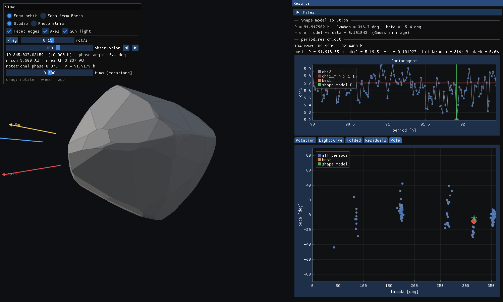
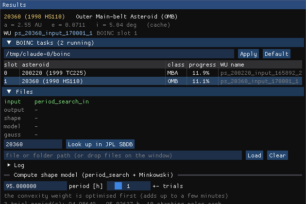
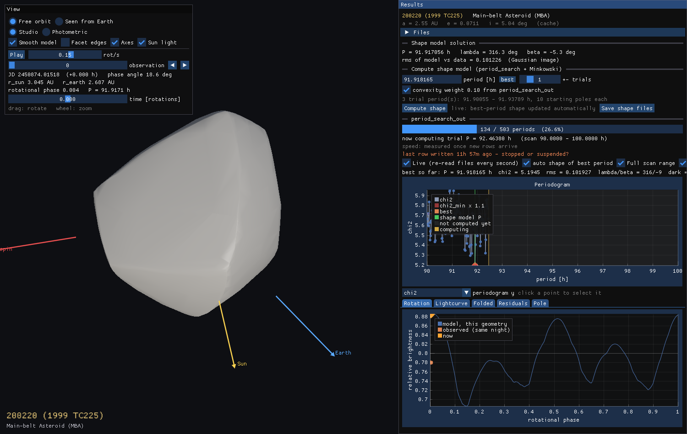
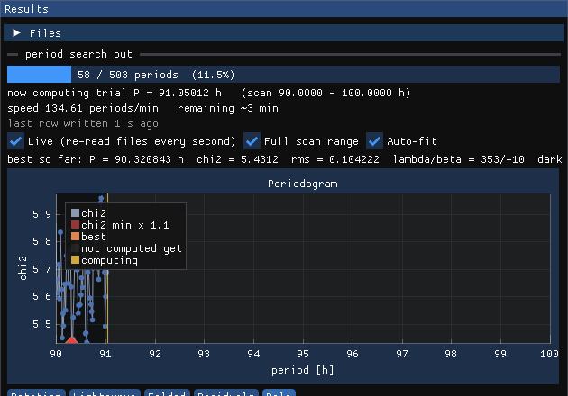

# Asteroid Viewer

An OpenGL 3.3 desktop viewer for `period_search` results. It can also compute shape models itself.
It shows:

* **Object**: name, orbit class and orbital elements from the
  [JPL Small-Body Database API](https://ssd-api.jpl.nasa.gov/doc/sbdb.html). The asteroid number comes from the file name.

* **3D shape model**: computed in the viewer (*Compute shape*) or loaded from an OBJ, flat-shaded, rotating about its spin axis.
  * *Free orbit*: drag to rotate, wheel to zoom. Arrows show the spin axis, Sun and Earth.
  * *Seen from Earth*: the asteroid as observed at the selected data point, lit by the Sun,
    in the correct rotational phase (pole, period, epoch and Φ0 from the fit).
  * *Photometric* shading uses the same Lambert + Lommel-Seeliger law as the fit.
    *Facet edges* outlines the real polygonal facets.
* **Periodogram**: χ² vs period from one or more `period_search_out` files (they are merged).
  The best row, the χ²_min×1.1 threshold and the model's period are marked. Click a point to select a row.
* **Rotation**: the synthetic lightcurve over one rotation at the current geometry, with that night's data points.
* **Lightcurve / Folded / Residuals**: observed vs model brightness for every data point.
  Click a data point in *Lightcurve* to jump to that observation.
* **Pole**: λ/β of every period and of the shape model.
* **Progress of a running calculation**: see below.
* **Compute shape**: runs period_search inside the viewer for the selected period, then builds the polyhedron. See below.
  With *Live* on, the shape of the best period is recomputed automatically.
* **Smooth model** (on by default): the fitted shape function drawn as a smooth surface instead of 288 flat facets.
* **rms**: the periodogram can show χ², rms or dark facet. The progress bar of *Compute shape* shows the current rms.

The C++ brightness model reproduces period_search exactly (the rms matches the value the patched period_search reports).



## Run

Windows: `bin/asteroid_viewer.exe` (prebuilt, a single exe with no DLLs needed), or `view_example.bat`.

Linux: `bin/asteroid_viewer` (prebuilt for x86-64, runs on any distribution with glibc 2.27 or newer: Ubuntu 18.04+,
Debian 10+, RHEL/Rocky 8+, Fedora). It needs only an X11 or XWayland session with OpenGL 3.3 and `curl` for the
JPL lookups. If the file lost its executable flag on the way, run `chmod +x bin/asteroid_viewer`.

```
asteroid_viewer [files or folders ...]
asteroid_viewer ..\..\period_search\period_search_in ..\..\period_search\period_search_out
```

Recognised files:

* `period_search_in`
* `period_search_out*`
* `*.obj`
* `cg_dump.txt`: best-fit parameters
* `shape_dump.txt`: Gaussian image, used for the exact photometric model

A folder is scanned for these files. Without arguments it scans the current folder.
You can also drop files or folders onto the window, or type a path into *Files → Load*.

To get a shape for any period, use *Compute shape* (or `--compute P`); *Save shape files* writes a `shape_<P>/` folder
that the viewer can load again.

Options: `--view free|earth|orbit --photometric --edges --obs N --tab Rotation|Lightcurve|Folded|Residuals|Pole|Orbit --size WxH`,
`--compute P` (start computing the shape for period P), `--auto-interval S`, `--boinc DIR`, `--slot N`, `--no-boinc`, and
`--screenshot out.ppm [--frames N] [--wait S] [--wait-compute]` to render one image and exit.

## BOINC

The viewer finds the Asteroids@home tasks your BOINC client is running and lists them under *BOINC tasks*
(collapsed by default; click the header to open it).



* **Data folder:** `C:\ProgramData\BOINC` by default. The BOINC installer's `DATADIR` registry value is used if it is set,
  On Linux the default is `/var/lib/boinc` (`/var/lib/boinc-client` if only that exists, as with older Debian/Ubuntu packages).
  Change it in the panel (*Apply*, saved in `%APPDATA%\asteroid_viewer\settings.ini`, on Linux
  `~/.config/asteroid_viewer/settings.ini`), or start with `--boinc DIR`.
  On Linux the slots belong to the `boinc` user; if no tasks are found, add yourself to its group
  (`sudo usermod -aG boinc $USER`, then log in again).
* **Running tasks:** every slot in `<data folder>\slots\N` that holds a period_search task is listed, rescanned every 5 s.
  The list shows slot, asteroid name, orbit class (e.g. *Main-belt Asteroid (MBA)*), progress (rows written / trial periods)
  and WU name.
  * The asteroid number comes from `<wu_name>` in the slot's `init_data.xml`. WU names have the form
    `ps_<batch date>_input_<asteroid>_<chunk>`, e.g. `ps_261007_input_167069_29` → asteroid 167069
    (261007 = the batch issued on 2026-10-07, 29 = the chunk of the period range).
  * Each number is looked up in JPL SBDB once and cached.
* **Order:** tasks are listed by % done, the most advanced first.
* **Auto switch** (on by default, saved), above the task list even when it is collapsed: when the shown task has made
  no progress (no new rows) for the **auto switch between tasks interval** (default 60 s, 30–3600 s, saved), the viewer
  shows the task the strategy picks. A task that keeps writing rows stays.
  * *finished tasks* – the next task of the finished-tasks cache, newest to oldest, then around again;
  * *running tasks (max % done)* (default) – the running task with the most work done;
  * *running tasks (min % done)* – the running task with the least work done, but at least 1 % done.

  **next (Ns)** counts down to the next automatic switch (it restarts whenever the shown task writes rows; it shows
  *shape* / *final shape* while a shape computation holds the switch). Click it to switch right away.
  For the running strategies the slots are rescanned just before choosing, so the current % done is used (the same
  value the list shows); complete tasks are skipped, and the candidates with their % are written to the log.
  A task that has just completed stays shown until the final shape of the run is computed (with the automatic best
  shape on). Files opened by hand (not from BOINC) are left alone.
* **When the shown task finishes** it is copied to the finished-tasks cache (below) and the viewer switches to that
  cached copy in place: same data, shape and plots, but no longer read from the BOINC slot, which BOINC may now
  empty or reuse. The panel then says *finished … (cached)*.
* **Reused slots:** when a task finishes, BOINC often starts a new work unit in the same slot folder. The viewer notices
  (the slot's `<wu_name>` changes) and stops reading that slot; with caching off it keeps the finished task's data
  on screen until the next switch.
* **Choosing a task:** click a row to open it; the previous task is closed. The slot's `period_search_in` /
  `period_search_out` are BOINC soft links, which the viewer follows to the files in `projects\`.
  The output is picked up as soon as BOINC writes it.
* **Shown with the asteroid:** the WU name and slot appear with the asteroid details, at the top of the panel
  (the result name is in the tooltip) and in the 3D view.
* **At start:** with no files given, the running task with the most work done opens automatically.
  `--slot N` opens a specific slot.

### Finished tasks cache

BOINC deletes a task's files once its result is reported. The viewer copies every finished task
(all trial periods written) out of the BOINC folder, so it can still be opened later:

* **Folder:** `%LOCALAPPDATA%\asteroid_viewer\finished_tasks\<WU name>\` (`period_search_in`, `period_search_out`, `task.txt`);
  `~/.cache/asteroid_viewer/finished_tasks` elsewhere. The environment variable `ASTEROID_VIEWER_CACHE` replaces
  `%LOCALAPPDATA%\asteroid_viewer`.
* **When:** at the slot scan that sees the task complete, or, if BOINC emptied the slot between two scans, from the
  task's files in `projects\` (they stay until the result is reported).
* **Finished tasks** section (below *BOINC tasks*, collapsed by default): click a row to open the task.
* **Shape model solution:** when an all-poles shape of a finished run is computed (the automatic final shape, or *Compute shape*), it is stored
  with the task in `<WU name>\shape\` (`asteroid_shape.obj`, `asteroid_shape_smooth.obj`, `cg_dump.txt`,
  `shape_dump.txt`, `solution.txt`). Opening the cached task loads it at once instead of computing it again; the list
  shows its period in the *shape P [h]* column.
* **quality** column – how well the run determines the model, from its `period_search_out`
  (hover for the details):
  * *good*: unique period – one narrow interval of trial periods with χ² below χ²_min × 1.1 – and a dark facet
    of the best period below 1 %;
  * *fair*: up to 3 competing period intervals (or a flat periodogram, where most periods are below the threshold)
    and a dark facet below 2 %;
  * *poor*: otherwise.

  A BOINC task covers only a part of the asteroid's period range, so its grade describes that part.
* **keep N tasks** (default 100, saved): the oldest are deleted first; 0 turns caching off.
* **Asteroid names:** the JPL SBDB answers are kept in `%LOCALAPPDATA%\asteroid_viewer\asteroid_names\<number>.json`,
  so each asteroid is looked up only once (also "not found" answers). Requests go out one at a time (the JPL API
  refuses bursts of parallel requests); a failed lookup is logged with its reason and tried again after 2 minutes,
  and *Look up in JPL SBDB* always asks right away. The section shows how many names are cached.
* **Clear cache** deletes all cached tasks and asteroid names (after a confirmation); names are then looked up again.

The viewer only reads the BOINC folders and never writes there. For a BOINC task, *Save shape files* writes to
`Documents\asteroid_viewer\<WU name>\shape_<P>\` instead.

## Computing a shape in the viewer

The controls are in the **Shape model solution** section (open by default; click its header to collapse it).
While a shape is being computed its progress bar and *Cancel* stay visible even when the section is collapsed.

1. Select a period: click a point in the periodogram, or use *best* / *selected*, or type a period.
2. Choose *± trials*: the number of neighbouring trial periods of the original scan grid to fit as well.
3. Press **Compute shape**. It is enabled once `period_search_out` has at least one row. The rows give the periods
   to choose from and the convexity weight that makes the result match period_search.

What happens:

* **The fit**: period_search's own fit runs in a background thread, with 10 starting poles per trial period.
  The progress bar shows the current pole, iteration and rms.
  * The numerical code is the repository's `period_search/*.c`, compiled as C.
  * `src/ps_core.cpp` is generated from `period_search_BOINC.cpp` by `scripts/gen_ps_core.py`. Only I/O changes.
  * By default it uses the convexity weight from the first row of `period_search_out`. Rows then match the BOINC
    output digit for digit.
    Without an output file, the weight is optimised first, as period_search does.
* **The polyhedron**: built from the best solution's facet areas (the Minkowski problem, `src/minkowski.cpp`, ~1 s).
* **The result**: shown immediately. The lightcurve tabs use the new model.
* **Save shape files**: writes `asteroid_shape.obj`, `shape_dump.txt` and `cg_dump.txt` to `shape_<P>/` next to the input
  (for BOINC tasks to `Documents\asteroid_viewer\<WU name>\`).

A trial period takes about 6 s on one core. Cancel stops the fit within one iteration.

### Automatic best shape while Live is on

With *Live* and *auto shape of best period* checked, the viewer checks whether the best row of
`period_search_out` changed (lowest χ²).

* **When it checks:** every *N* seconds; the interval is set next to the checkbox, 1–3600 s, default 10,
  or with `--auto-interval S`. It also checks again right after an automatic shape finishes,
  so a best row that arrived meanwhile isn't kept waiting a whole interval.
* **When the best row changed:** it computes the shape quickly:

* only that row's trial period;
* only **one starting pole**, the row's own λ/β, instead of the standard 10.

This takes about 1 s for the fit plus about 2 s for the smooth model.

* **When the run is complete** (`period_search_out` has all rows): the best shape is computed once more with all 10
  starting poles, which reproduces the best row exactly. This happens again only if the best row changes,
  e.g. when another output file is merged in.
The result starts from a converged pole, so it can end slightly below the row's rms; it is not a digit-for-digit
reproduction of that row. For that, use *Compute shape*, which uses all 10 poles.
A run that is already in progress is never interrupted.



## Smooth model

period_search describes the shape by a curvature function, `exp(Σ c_lm Y_lm)` (L = M = 6), sampled on 288 facets.

* **Smooth model on** (default):
  * the same function is evaluated on 800 facets and turned into a polyhedron with the same Minkowski solver;
  * the small non-closure is spread over all facets instead of being put into one flat "dark facet";
  * the surface is drawn with smooth shading (vertex normals).
* **Smooth model off**: the polyhedron exactly as period_search fits it, with flat facets.

The lightcurve fit and rms always use the exact Gaussian image the fit produced, whichever model is shown.
*Save shape files* also writes `asteroid_shape_smooth.obj`. The smooth model is also built for models loaded from
files (`cg_dump.txt` + `period_search_in`). For a plain OBJ only the shading is smoothed.

## Object name (JPL SBDB)

The designation is taken from the input/output file names:

| file name | designation |
|---|---|
| `period_search_in_20360`, `period_search_out_20360` | `20360` |
| BOINC work unit `ps_260930_input_110501_2` (also behind slot soft links) | `110501` |
| otherwise | the last number with 3 or more digits |

You can also type a designation under *Files* and press *Look up in JPL SBDB*.

Answers are cached in `%LOCALAPPDATA%\asteroid_viewer\asteroid_names\` (see *Finished tasks cache*; *Clear cache*
resets it). A `<number>_rdbd.json` file next to the input (written by `graphic_app`) is used as well, so it also works offline.
On Windows the request goes through WinHTTP and uses the system proxy settings. Elsewhere it uses `curl`.

## Orbit

**In the 3D view:** choose **Solar system** in the *View* window (or start with `--view orbit`). The asteroid's orbit
(*q* = perihelion; the arc where the asteroid can be seen from the Earth at that moment – solar elongation above 90°,
i.e. in the night sky, reflecting sunlight towards us – is lit, brightest and yellowest towards opposition; it moves
with the Earth; the rest of the orbit is grey; a ring marks the asteroid), the planets' orbits and positions at the shown
observation's date, faint 1–5 AU circles in the ecliptic and the vernal-equinox direction are drawn around the Sun;
the shape model sits at the asteroid's position, enlarged to a constant size, rotating and lit by the Sun, with the
line of sight from the Earth. Drag to rotate, wheel to zoom; the observation slider moves everything in time.

**Asteroid orbit:** fitted to the asteroid positions in `period_search_in` (two-body Kepler orbit, least squares;
typically 0.001–0.005 AU from the observed positions), so it runs through them and sits exactly among the planets.
The JPL SBDB elements are used only when no orbit can be fitted. The *Orbit* tab says which one is shown.

**Play observations** (View window, or `--play-obs`) runs the observations in time order, looping at the end, in any
view. In *Solar system* with a known orbit it is a continuous time-lapse (*days/s*, 1–365): the asteroid and the planets move along their orbits,
the asteroid turned as the rotation model says, and each observation is shown as the clock passes it (between
observations the top right says when the next one comes). In *Free orbit* and *Seen from Earth* (and without an orbit) it steps from observation to
observation (*obs/s*): the body as it was turned and lit at each measurement. It stays on when another task is opened (by hand or by auto switch) and is remembered across restarts.
The top right shows the date, *observation k / N*, observed and model brightness (also as bars) and the
lightcurve's label; observations already passed are drawn brighter.


The *Orbit* tab draws the asteroid's orbit with the Sun and the orbits of Mercury to Jupiter, seen from the ecliptic
north pole (*top view*) or edge-on (*side view*, x–z):

* **Orbit:** from the JPL SBDB elements (a, e, i, node, perihelion, mean anomaly at the epoch); the elements are
  listed above the plot.
* **Positions at the observations:** taken directly from the Sun and Earth vectors in `period_search_in`
  (green dots), so they appear even without the SBDB answer. The shown observation is marked, with the line of sight
  from the Earth; the planets are placed at its date (JPL approximate planet positions).

## Monitoring a running period_search

Loading only the input is enough. The viewer looks for the matching output every second, whether Live is on or not.
It loads the output as soon as the file appears, and shows *waiting for …* until then.
It looks for `period_search_out_20360` next to `period_search_in_20360`, and for `period_search_out` in the same folder
(which also covers BOINC slots).

Open the run's `period_search_in` and `period_search_out`, or just its folder. The viewer re-reads them every second.
It only uses complete lines, so reading a file that is still being written is safe.



* **Progress bar**: rows written / total number of trial periods. The total is computed from the input exactly
  as period_search does: `(1/P_start − 1/P_end) / step + 1`, with `step = 0.5 / (JD_max − JD_min) / 24 × step_coef`.
* **Status**:
  * the trial period being computed now;
  * speed in periods/min and the remaining time, measured from the rows that arrive while the viewer is open;
  * when the last row was written, with a warning when the run seems to have stopped or been suspended;
  * a note when there are no rows yet. period_search first optimises the convexity weight and writes nothing during that step.
* **Periodogram**: check *Full scan range* (off by default) to show the whole scan range. The part not computed yet is
  then shaded, and the current trial period is marked.
* **Auto-fit** (on by default): applies to all plots, which then follow their data as it updates. Turn it off to zoom and pan freely.
* **Window title**: shows the percentage, e.g. `[26.6%]`.
* **BOINC**: point the viewer at a slot folder (e.g. `C:\ProgramData\BOINC\slots\3`).
  The `<soft_link>` stubs there are followed to the real files in the project folder.
* **Mismatched input**: if the loaded `period_search_in` doesn't match the output, the viewer says so.
  This happens with the narrowed input in a `shape_<P>/` folder: load the original input explicitly.
  An input file given on the command line takes precedence over one found in a folder.

## Troubleshooting

* **Slow UI:** the log records a `perf:` line every 10 s in which a frame took more than 50 ms, with the slowest
  parts of the frame (max/avg ms). Set the environment variable `ASTEROID_VIEWER_PROFILE=1` to log it always.
  BOINC slots are scanned in a background thread; long periodograms are drawn as min/max per screen column.

* **Log:** every run writes `asteroid_viewer.log` next to the program. If that folder is not writable, the log goes to
  `%APPDATA%\asteroid_viewer\`. It records the startup steps, the BOINC folder and tasks found, files loaded and computations.
* **If the program has to stop:** it shows a message with the reason.
* **`--no-boinc`:** skips the BOINC scan.
* **Non-ASCII paths:** paths with non-ASCII letters, e.g. a Windows user name with Czech characters, are supported.
  The program handles all paths and environment variables as Unicode.

## Build

The period_search sources are copied to the build folder with `POINTS_MAX` (points in one lightcurve) raised from
1000 to 20000 (`-DPS_POINTS_MAX=...`), because current BOINC work units contain longer lightcurves (e.g. ATLAS with
~1500 points); `mrqcof.c`'s work arrays are made static there so they don't overflow the thread stack. The originals
in `period_search/` are not changed. CMake 3.18 or newer is needed.

Needs CMake ≥ 3.16, a C/C++17 compiler and git. GLFW 3.4, Dear ImGui 1.91.5 and ImPlot 0.16 are
downloaded at configure time. There is no GLEW/glad: `src/gl_loader.*` loads the GL functions itself.
The period_search sources are taken from `../../period_search`; set `-DPERIOD_SEARCH_DIR=...` to use another folder.

```
cmake -S . -B build -DCMAKE_BUILD_TYPE=Release
cmake --build build --config Release
```

* Visual Studio 2019/2022: *Open Folder*, or the commands above in a Developer prompt.
* Linux: you also need `libx11-dev libxrandr-dev libxinerama-dev libxcursor-dev libxi-dev`. A build made this way runs on
  your distribution and newer ones.
* Linux, portable (as `bin/asteroid_viewer`): `scripts/build_linux_portable.sh` builds with zig (`pip install ziglang`)
  against glibc 2.27 and links the C++ runtime in, so the binary runs on older distributions too.
* Windows exe from Linux: `cmake -B build-win -DCMAKE_TOOLCHAIN_FILE=cmake/mingw-w64-x86_64.cmake` (needs mingw-w64).

## Source

| file | |
|---|---|
| `src/main.cpp` | window, camera, UI panels and plots |
| `src/data.*` | readers for period_search_in/out, OBJ, cg_dump, shape_dump |
| `src/model.*` | rotation (period_search `matrix.c`/`blmatrix.c`) and brightness (`bright.c`, `phasec.c`, `mrqcof.c` normalisation) |
| `src/renderer.*` | mesh upload and shaders (studio / photometric shading, facet edges) |
| `src/gl_loader.*` | minimal OpenGL 3.3 core loader |
| `src/ps_core.*` | period_search as a function (generated by `scripts/gen_ps_core.py`) |
| `src/compute.*` | background shape computation (fit, then Minkowski), progress and saving |
| `src/minkowski.*` | convex polyhedron from facet areas (polar convex hull + L-BFGS) |
| `src/sbdb.*` | JPL SBDB lookup (WinHTTP / curl), designation from file names, small JSON parser |
| `src/cache.*` | finished-tasks cache outside the BOINC folder |
| `src/boinc.*` | BOINC data folder, slot scan (`init_data.xml`, `boinc_task_state.xml`), settings file |
